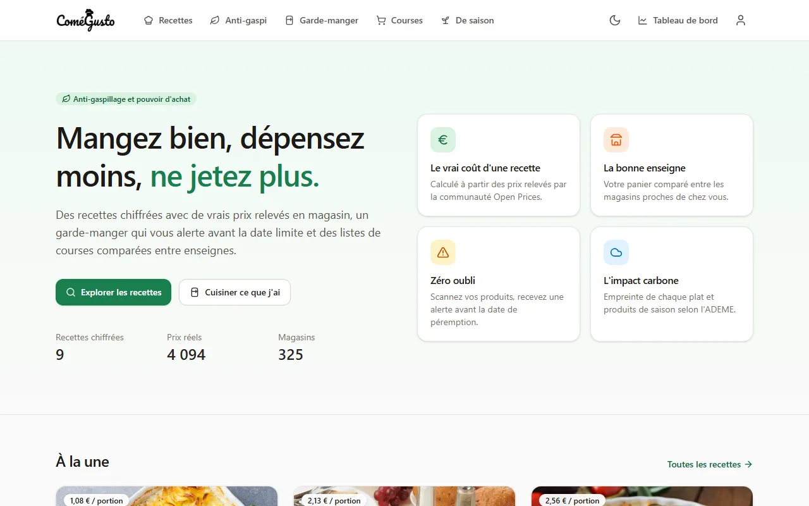
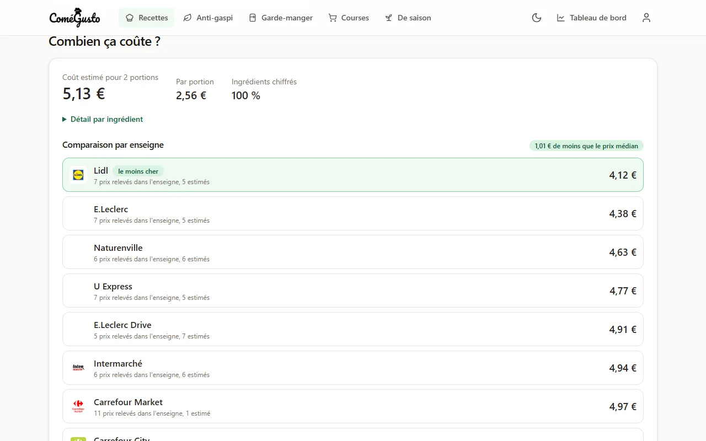
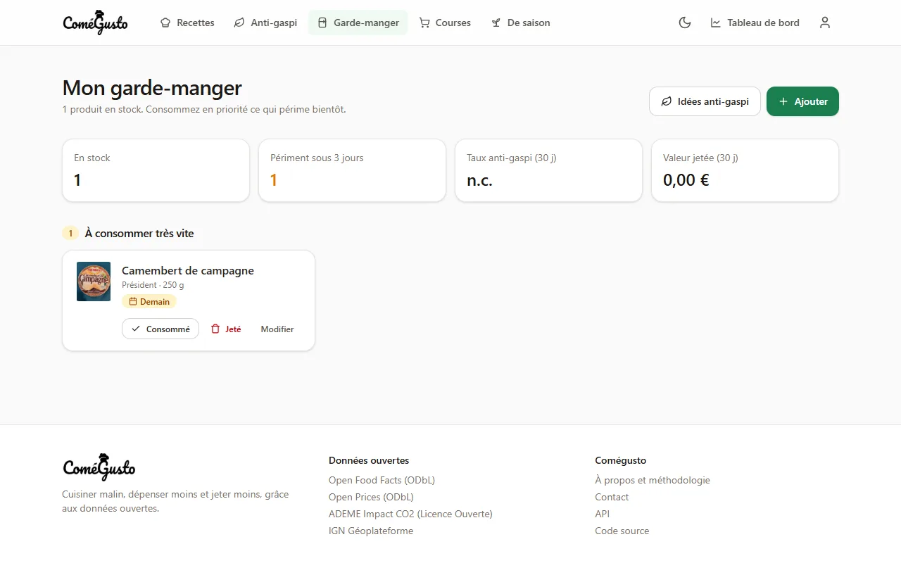
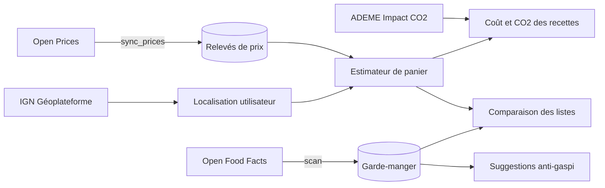

<p align="center">
  
</p>

<p align="center">
  <strong>Cuisiner malin, dépenser moins, ne plus jeter.</strong><br>
  Recettes chiffrées avec de vrais prix, garde-manger anti-gaspi et listes de courses comparées entre enseignes, grâce aux données ouvertes.
</p>

<p align="center">
  <a href="https://github.com/Aziguy/reaco_updated/actions/workflows/ci.yml"></a>
  
  
  
  <a href="LICENSE"></a>
  <a href="https://aziguy.github.io/reaco_updated/"></a>
</p>

---

## Pourquoi Comégusto ?

Chaque Français jette en moyenne une trentaine de kilos de nourriture par an, pendant que le budget alimentaire pèse de plus en plus lourd. Comégusto relie trois gestes du quotidien :

1. **Choisir quoi cuisiner** en connaissant le coût réel d'une recette et son empreinte carbone.
2. **Acheter au bon endroit** en comparant son panier entre les enseignes proches de chez soi.
3. **Consommer avant qu'il ne soit trop tard** grâce à un garde-manger qui alerte et propose des recettes.

| Accueil | Comparateur de prix | Garde-manger |
| --- | --- | --- |
|  |  |  |

## Documentation

| Pour qui | Où |
| --- | --- |
| Utilisateurs | Guide intégré à l'application sur `/guide/` : chaque fonctionnalité expliquée avec des captures annotées, en thème clair et sombre. |
| Développeurs | [Documentation développeur](https://aziguy.github.io/reaco_updated/) : installation, architecture, tests, déploiement, configuration, maintenance et évolution. |

## Fonctionnalités

**Recettes**
- 31 recettes de démonstration, économiques et anti-gaspi (pain perdu, hachis parmentier, riz cantonais, banana bread…), illustrées par des photos sous licence libre.
- Recherche instantanée insensible aux accents (titre, ingrédients, régimes), filtres combinables (type de plat, régime, difficulté, temps) et tri par date, prix, durée ou CO2, avec pagination stable et URL partageables.
- Ajustement des portions, quantités recalculées à la volée.
- Coût par portion calculé à partir de prix réels, détail par ingrédient.
- Empreinte carbone par portion (ADEME Agribalyse) et badge « de saison ».
- Valeurs nutritionnelles par portion (énergie, protéines, lipides, glucides) calculées à partir de la table Ciqual 2025 de l'Anses.
- Favoris.

**Comparateur de prix**
- Prix médians observés sur 12 mois, hors promotions, ramenés au kilo, au litre ou à la pièce.
- Classement des enseignes pour une recette ou une liste de courses, avec la part de prix réellement relevés.
- Recherche géographique autour du code postal de l'utilisateur, repli national si les relevés locaux manquent.

**Garde-manger anti-gaspi**
- Ajout par scan de code-barres (caméra du téléphone) ou saisie, fiche complétée par Open Food Facts (Nutri-Score, Green-Score, image) et valeur estimée par Open Prices.
- Classement par urgence (date dépassée, sous 3 jours, plus tard).
- Suivi « consommé » ou « jeté », taux anti-gaspi et valeur jetée sur 30 jours.
- Rappels par email avant péremption.
- Suggestions de recettes qui utilisent en priorité les produits qui périment.

**Listes de courses**
- Ajout d'une recette pour un nombre de portions donné, fusion des quantités, déduction du stock du garde-manger.
- Articles regroupés par rayon, cochables, version imprimable.
- Rangement des achats dans le garde-manger en un clic.

**Et aussi**
- Calendrier des fruits et légumes de saison.
- Guide utilisateur intégré, avec captures annotées générées automatiquement.
- API REST documentée (OpenAPI).
- Mode sombre, responsive, accessible au clavier.
- Suppression du compte et de toutes les données en libre-service.

## Données ouvertes utilisées

| Service | Usage | Licence |
| --- | --- | --- |
| [Open Prices](https://prices.openfoodfacts.org) | Prix observés en magasin, recherche géographique | ODbL |
| [Open Food Facts](https://world.openfoodfacts.org) | Fiches produits, Nutri-Score, Green-Score, taxonomie des catégories | ODbL |
| [ADEME Impact CO2](https://impactco2.fr) | Empreinte carbone des aliments, calendrier de saison | Licence Ouverte 2.0 |
| [Anses Ciqual 2025](https://ciqual.anses.fr) | Composition nutritionnelle des ingrédients | Licence Ouverte 2.0 |
| [IGN Géoplateforme](https://geoservices.ign.fr) | Géocodage des codes postaux | Licence Ouverte 2.0 |
| [OpenStreetMap](https://www.openstreetmap.org) | Magasins (via Open Prices) | ODbL |

Les appels sont faits par un client HTTP commun : délai maximal, nouvelles tentatives sur les erreurs 429 et 5xx, User-Agent identifiable, cache des réponses et mémorisation des pannes pour ne jamais bloquer une page.

## Démarrage rapide avec Docker

```bash
cp .env.example .env
docker compose up -d --build
docker compose exec web python manage.py seed_demo
docker compose exec web python manage.py sync_prices
docker compose exec web python manage.py createsuperuser
```

L'application est disponible sur <http://localhost:8000>, l'administration sur `/admin/` et la documentation de l'API sur `/api/docs/`.

La pile comprend PostgreSQL, Redis, l'application (Gunicorn + WhiteNoise) et un planificateur qui synchronise les prix et envoie les rappels une fois par jour.

## Déploiement

Le [guide de déploiement](https://aziguy.github.io/reaco_updated/deploiement/hebergeurs/) détaille :

- un comparatif des hébergeurs **gratuits** (Oracle Cloud Always Free, Render + Neon, Cloud Run) et **payants** (VPS Hetzner, OVHcloud ou Scaleway, Clever Cloud, Scalingo, Railway…) ;
- le déploiement sur un VPS avec `docker-compose.prod.yml` et Caddy (HTTPS automatique, médias servis par Caddy) ;
- le déploiement sur une plateforme PaaS, le stockage S3 des médias, les tâches planifiées (y compris via GitHub Actions), les sauvegardes et une checklist de mise en production.

En résumé, sur un serveur avec un nom de domaine :

```bash
cp .env.example .env   # DOMAIN, SECRET_KEY, POSTGRES_PASSWORD, EMAIL_URL...
docker compose -f docker-compose.yml -f docker-compose.prod.yml up -d --build
```

## Développement local

Prérequis : [uv](https://docs.astral.sh/uv/) et Node.js 20+ (22.23+ pour construire la documentation).

```bash
uv sync                     # dépendances Python (crée .venv)
npm install && npm run build
cp .env.example .env        # DEBUG=true, base SQLite si DATABASE_URL est vide
uv run python manage.py migrate
uv run python manage.py seed_demo
uv run python manage.py sync_prices
uv run python manage.py runserver
```

Pendant le développement, `npm run dev` recompile les styles à chaque modification.

### Commandes utiles

| Commande | Rôle |
| --- | --- |
| `seed_demo [--refresh-images]` | Charge les 83 ingrédients et 31 recettes de démonstration avec leurs photos (idempotent). |
| `sync_prices [slug ...] [--days N] [--pages N]` | Importe les prix Open Prices puis recalcule les recettes. |
| `refresh_metrics` | Recalcule coût, empreinte carbone et valeurs nutritionnelles (automatique à chaque enregistrement dans l'administration). |
| `send_expiry_reminders [--days N]` | Envoie les rappels de péremption. |

## Configuration

Toute la configuration passe par des variables d'environnement (voir `.env.example`). Le [guide de configuration](https://aziguy.github.io/reaco_updated/deploiement/configuration/) explique pas à pas :

- l'**envoi d'emails** : format de `EMAIL_URL`, fournisseurs (Brevo, boîte mail du domaine, Gmail), délivrabilité, test et dépannage ;
- la **connexion avec Google** : création du client OAuth et URL de redirection ;
- le domaine, la sécurité, la base, le cache, les médias, les prix, les tâches planifiées et les alertes d'erreur ;
- la référence complète des variables.

Les variables essentielles en production :

| Variable | Exemple |
| --- | --- |
| `SECRET_KEY` | chaîne aléatoire longue |
| `DOMAIN` ou `ALLOWED_HOSTS` + `CSRF_TRUSTED_ORIGINS` | `comegusto.example.org` |
| `DATABASE_URL` (ou `POSTGRES_PASSWORD` avec Docker Compose) | `postgres://...` |
| `EMAIL_URL`, `DEFAULT_FROM_EMAIL`, `CONTACT_EMAIL` | `smtp+tls://...@smtp-relay.brevo.com:587` |
| `ADMIN_URL` | `gestion-8f3k/` |

## Architecture

```
config/              réglages, URLs, WSGI/ASGI
apps/
  core/              accueil, tableau de bord, saison, contact, santé, balises de templates
  accounts/          utilisateur (connexion par email), profil, localisation, suppression RGPD
  recipes/           ingrédients, recettes, unités et conversions, coût et CO2 par portion
  integrations/      clients Open Food Facts, Open Prices, Impact CO2, géocodage IGN
  pricing/           magasins, relevés de prix, synchronisation, estimateur de panier
  pantry/            garde-manger, scan, statistiques, suggestions, rappels
  shopping/          listes de courses, fusion, déduction du stock, comparaison
  api/               API REST (DRF) et schéma OpenAPI
  guide/             guide utilisateur intégré, commande de capture des figures
templates/           gabarits Django (HTMX pour les interactions)
assets/app.css       source Tailwind CSS v4, compilée vers static/css/app.css
demo/                recettes de démonstration, photos et crédits (images/credits.json)
deploy/              configuration Caddy pour la production
docs/                documentation développeur (Astro Starlight), captures du README
```



### Valeurs nutritionnelles

Chaque ingrédient est relié à un aliment de la table Ciqual 2025 (code et valeurs pour 100 g dans `demo/ciqual.json`, modifiables dans l'administration). Les quantités de la recette sont converties en grammes (poids moyen d'une pièce, densité 1 pour les liquides et les cuillères), puis les apports sont additionnés et divisés par le nombre de portions. La part des ingrédients couverts est affichée quand elle n'est pas de 100 %.

### Calcul des prix

1. Chaque ingrédient est relié à une catégorie Open Food Facts (`en:tomatoes`, `en:butters`…).
2. `sync_prices` importe les relevés récents de cette catégorie : prix « vrac » au kilo ou à la pièce et, s'ils sont trop rares, prix de produits emballés ramenés au kilo ou au litre grâce à leur contenance.
3. Les prix vrac sont préférés dès qu'il y en a au moins cinq, car les catégories larges contiennent aussi des produits transformés.
4. L'estimateur retient la médiane des prix, globalement puis par enseigne, en écartant les prix plus de 4 fois éloignés de la médiane. Pour une enseigne, un ingrédient sans relevé est compté au prix médian, et la part de prix réellement relevés est affichée.

## API

La documentation interactive est servie sur `/api/docs/` et le schéma sur `/api/schema/`.

| Point d'accès | Accès |
| --- | --- |
| `GET /api/v1/recipes/` et `/api/v1/recipes/{slug}/` | public |
| `GET /api/v1/recipes/{slug}/estimate/?servings=&lat=&lon=&radius_km=` | public |
| `GET /api/v1/ingredients/` | public |
| `/api/v1/pantry/` | authentifié, propre à l'utilisateur |
| `/api/v1/shopping-lists/`, `POST .../{id}/add-recipe/` | authentifié |
| `GET /api/v1/products/{code-barres}/` | authentifié |

Authentification par session ou par jeton (`Authorization: Token ...`, jetons gérés dans l'administration).

## Qualité

```bash
uv run pytest --cov          # 150+ tests, appels externes simulés
uv run ruff check . && uv run ruff format --check .
uv run pre-commit install    # vérifications avant chaque commit
```

La CI GitHub Actions exécute le lint, les tests sur PostgreSQL, `check --deploy` et la construction de l'image Docker.

## Sécurité

- Aucun secret dans le code : configuration par variables d'environnement.
- Content Security Policy stricte (aucun script ni style en ligne), HSTS, cookies sécurisés, `X-Frame-Options: DENY`.
- Limitation de débit sur l'authentification (allauth), l'API et le formulaire de contact (avec pot de miel).
- Isolation stricte des données par utilisateur, couverte par des tests.
- Images externes restreintes aux domaines Open Food Facts.

Pour signaler une vulnérabilité, merci d'écrire à l'adresse de contact plutôt que d'ouvrir une issue publique.

## Feuille de route

Le suivi se fait dans les [issues](https://github.com/Aziguy/reaco_updated/issues). Pistes : contribution de prix vers Open Prices depuis l'application, import de recettes, planning de repas hebdomadaire, notifications push, application mobile installable (PWA).

## Contribuer

Les contributions sont bienvenues : voir [CONTRIBUTING.md](CONTRIBUTING.md).

## Licence

Code sous licence [MIT](LICENSE). Les photos des recettes proviennent de Wikimedia Commons sous licences CC0, CC BY ou CC BY-SA : leurs auteurs et licences sont indiqués sous chaque photo, sur la page `/credits/` et dans `demo/images/credits.json`. Les données issues d'Open Food Facts, d'Open Prices et d'OpenStreetMap restent sous licence ODbL, celles de l'Anses (Ciqual), de l'ADEME et de l'IGN sous Licence Ouverte 2.0.
