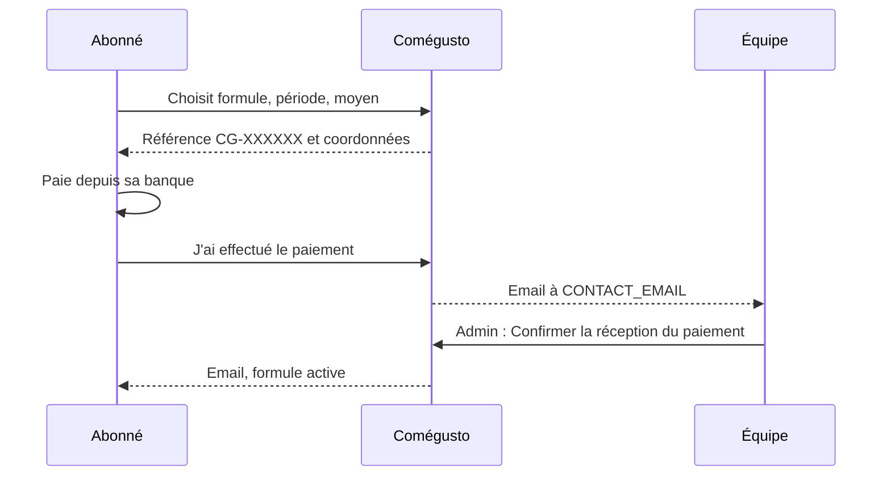

L'application `apps/billing` finance le site sans chercher le profit : les fonctions sans IA restent gratuites, et les formules payantes augmentent les quotas de l'assistant.

| URL | Page |
| --- | --- |
| `/abonnement/` | Formules et tarifs, mensuel ou annuel |
| `/abonnement/choisir/<formule>/` | Choix de la période et du moyen de paiement |
| `/abonnement/paiement/<référence>/` | Instructions de virement ou Wero, « J'ai effectué le paiement » |
| `/abonnement/mon-abonnement/` | Formule, utilisations du jour, paiements en attente, historique |
| `/abonnement/ou-va-votre-argent/` | Frais du mois et part couverte par les abonnements |
| `/abonnement/stripe/webhook/` | Événements Stripe signés (404 tant que Stripe n'est pas configuré) |

## Modèles

| Modèle | Rôle | Champs notables |
| --- | --- | --- |
| `Plan` | Formule | prix mensuel et annuel, `deep_mode` (accès au mode Approfondi), `is_default` (formule des comptes sans abonnement), avantages (un par ligne), identifiants de prix Stripe |
| `PlanQuota` | Quota de l'assistant d'une formule | `feature`, `daily` |
| `Subscription` | Période payée | `plan`, `period`, `method` (`transfer`, `wero`, `stripe`), `status` (`pending`, `active`, `canceled`), `reference` unique (CG-XXXXXX), `amount`, `starts_on`, `ends_on`, `declared_at`, `confirmed_at`, identifiants Stripe |
| `PaymentSettings` | Réglages uniques | coordonnées bancaires, identifiant Wero, activation de Stripe, message aux abonnés |
| `Expense` | Frais mensuel affiché publiquement | libellé, catégorie, montant |

`python manage.py setup_billing` crée les formules Gratuit, Plus (2,99 € par mois, 24,99 € par an) et Famille (4,99 €, 39,99 €) avec leurs quotas, sans écraser l'existant. Le conteneur l'exécute au démarrage.

## Quotas de l'assistant

`services.quota()` de l'assistant prend, dans l'ordre :

1. le quota visiteur de la route (`Route.anonymous_quota`) pour un visiteur ;
2. le `PlanQuota` de la formule de l'utilisateur : celle de son abonnement en cours, sinon la formule par défaut ;
3. le quota de la route (`Route.daily_quota`) si la formule ne fixe rien pour cette fonctionnalité.

Pour un compte sans abonnement, le compteur du jour additionne les appels des comptes gratuits vus sur le même appareil (voir [Sécurité](/reaco_updated/architecture/securite/#comptes-multiples)). L'assistant demande aussi une adresse email vérifiée.

Le mode Approfondi exige une formule avec `deep_mode`. Les comptes de l'équipe en sont dispensés, et la génération du catalogue (`catalog`) n'a pas de quota de formule.

| Fonctionnalité | Gratuit | Plus | Famille |
| --- | --- | --- | --- |
| Recherche | 10 | 50 | 120 |
| Menu de la semaine | 1 | 3 | 6 |
| Création de recette (frigo, plat, sur mesure) | 2 | 8 | 20 |
| Ticket de caisse | 1 | 8 | 15 |
| Photo des ingrédients | 2 | 8 | 20 |

Au tarif mesuré (environ 0,001 $ par appel en mode Rapide), un abonné Plus qui utilise tous ses quotas chaque jour coûte moins de 2 $ par mois.

## Virement et Wero

- Coordonnées dans **Abonnements > Réglages de paiement** : titulaire, IBAN, BIC, banque, identifiant Wero (téléphone ou email). Un moyen n'est proposé que s'il est coché et renseigné.
- Une demande en attente identique est réutilisée, sans créer de doublon.
- `services.activate()` fait démarrer une nouvelle période le lendemain de la formule en cours : un renouvellement s'ajoute.
- Rien n'est prélevé : à la fin de la période, le compte revient à la formule par défaut.

## Stripe

L'intégration est livrée désactivée. Pour l'activer :

1. Créez dans Stripe un produit par formule et un prix récurrent mensuel et annuel, puis copiez les identifiants `price_…` dans chaque formule.
2. Ajoutez un point de terminaison de webhook vers `https://votre-domaine/abonnement/stripe/webhook/` avec les événements `checkout.session.completed`, `invoice.paid` et `customer.subscription.deleted`.
3. Définissez `STRIPE_SECRET_KEY` et `STRIPE_WEBHOOK_SECRET`, puis cochez **carte bancaire (Stripe) proposée** dans les réglages de paiement.

Le paiement passe par Stripe Checkout (page hébergée, aucune donnée de carte chez Comégusto) et la gestion de la carte par le portail client. Le webhook vérifie la signature, active l'abonnement, prolonge sa fin à chaque facture payée et l'annule à la résiliation.

## Page « Où va votre argent »

Les frais saisis dans **Frais mensuels** s'ajoutent au coût réel de l'assistant du mois (journal des appels, converti avec `BILLING_USD_TO_EUR`). Le taux de couverture compare ce total aux abonnements en cours, les abonnements annuels comptant pour un douzième.
