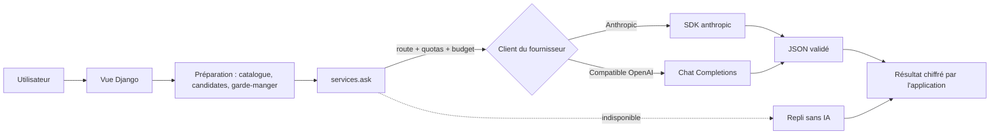

L'application `apps/assistant` ajoute des fonctionnalités qui s'appuient sur un modèle de langage :

| Fonctionnalité | URL | Rôle du modèle | Ce que calcule l'application |
| --- | --- | --- | --- |
| Recherche en langage naturel | `/assistant/recherche/` | Traduire une phrase en critères | Recettes correspondantes, assouplissement, prix, CO2 |
| Menu de la semaine | `/assistant/menu/` | Choisir parmi des recettes présélectionnées et expliquer | Présélection, coût, CO2, produits sauvés, liste de courses |
| Vider le frigo | `/assistant/frigo/` | Écrire une recette avec les ingrédients connus | Correspondance des ingrédients, prix, CO2, nutrition |
| Ticket de caisse | `/assistant/ticket/` | Lire la photo d'un ticket | Correspondance des ingrédients, écran de vérification |
| Cuisiner avec ce que j'ai | `/assistant/cuisiner/` | Écrire un plat absent du catalogue ou une recette sur mesure, lire une photo d'ingrédients | Plat du catalogue, ingrédients manquants, panier des manquants par enseigne proche |
| Génération du catalogue | Admin, **Recettes > Générer avec l'IA** | Proposer des plats absents, puis les écrire | Brouillons en relecture, ingrédients à vérifier |

## Principe : le modèle choisit, l'application chiffre

Le modèle ne produit jamais un prix, une empreinte carbone ou une valeur nutritionnelle. Il reçoit les données utiles (catalogue d'ingrédients, recettes candidates avec leurs chiffres, produits du garde-manger) et répond par un JSON contraint par un schéma. L'application valide ce JSON, ignore les valeurs hors schéma (identifiant de recette inconnu, régime inexistant) et calcule elle-même les chiffres affichés.



## Modules

| Fichier | Rôle |
| --- | --- |
| `models.py` | `Provider`, `AIModel`, `Route`, `Usage` (journal), `MealPlan` et `PlannedMeal` |
| `providers.py` | Clients `AnthropicClient` et `OpenAICompatibleClient` : invite, schéma et images en entrée, dictionnaire en sortie |
| `services.py` | `ask()` : choix de la route, quotas, plafond mensuel, modèle de secours, journal des appels |
| `search.py` | Interprétation, critères signés, application et assouplissement, analyseur de secours |
| `planner.py` | Présélection, appel au modèle, menu de secours, remplacement d'un repas, liste de courses |
| `generator.py` | Recette écrite par le modèle à partir d'un `Brief` (plat demandé, produits disponibles, cuisine), en brouillon ; ingrédients inconnus créés « à vérifier » |
| `cook.py` | Page Cuisiner : ce que l'on a, plat du catalogue, ingrédients manquants, suggestions, localisation |
| `photo.py` | Aliments reconnus sur une photo |
| `catalog.py`, `admin_views.py` | Suggestion de plats et génération par lot depuis l'administration |
| `receipts.py` | Lecture d'un ticket, réduction de l'image, lignes à vérifier |
| `management/commands/setup_assistant.py` | Configuration par défaut |

## Fournisseurs, modèles et routes

Tout se règle dans l'administration, section **Assistant IA**, sans redéploiement.

- **Fournisseur** : type (`anthropic` ou compatible OpenAI), URL de l'API et **nom** de la variable d'environnement qui contient la clé. La clé n'est jamais stockée en base.
- **Modèle** : identifiant chez le fournisseur, lecture des images, niveau de réflexion réglable, prix par million de jetons (pour le journal des coûts).
- **Route** : pour chaque fonctionnalité et chaque mode (**Rapide**, **Approfondi**), le modèle, le modèle de secours, le niveau de réflexion, la limite de jetons de sortie et les quotas journaliers.

Les utilisateurs ne voient pas la liste des modèles : ils choisissent **Rapide** ou **Approfondi**, et l'administration décide à quoi correspond chaque mode. Si le mode Approfondi n'a pas de route, la route Rapide est utilisée.

`python manage.py setup_assistant` crée la configuration par défaut sans écraser l'existant ; le conteneur l'exécute au démarrage.

| Fournisseur | Variable | Remarques |
| --- | --- | --- |
| Anthropic | `ANTHROPIC_API_KEY` | Modèles par défaut : Claude Haiku 5.5 en mode Rapide, Claude Sonnet 5.5 en mode Approfondi |
| GitHub Models | `GITHUB_MODELS_TOKEN` | Jeton GitHub avec la permission `models:read`. Gratuit avec des limites basses : pour le développement |
| Mistral | `MISTRAL_API_KEY` | Hébergé dans l'Union européenne, modèle de secours par défaut |
| Ollama | aucune | Modèles locaux (Llama…), désactivé par défaut. Utile hors ligne |

Groq, OpenRouter ou Scaleway s'ajoutent comme fournisseurs compatibles OpenAI : URL de base de l'API et variable de la clé.

:::caution[GitHub Copilot]
L'API interne de Copilot n'est pas prévue pour des applications tierces. Pour utiliser un jeton GitHub, passez par GitHub Models.
:::

### Niveau de réflexion

Pour Anthropic, la route fixe `output_config.effort` (`low`, `medium`, `high`). Pour un fournisseur compatible OpenAI, le niveau est envoyé dans `reasoning_effort` seulement si le modèle est marqué « niveau de réflexion réglable ». Sur Claude Sonnet 5.5 et Opus 5.5, le repli côté serveur en cas de refus (`fallbacks: "default"`) est activé.

## Coûts et garde-fous

| Garde-fou | Réglage |
| --- | --- |
| Quota par utilisateur et par jour | Quota de la formule (`PlanQuota`, voir [Abonnements](/reaco_updated/architecture/abonnements/)), sinon `Route.daily_quota` ; compté sur les appels réussis du journal |
| Mode Approfondi | Réservé aux formules avec `deep_mode` |
| Quota par visiteur et par jour | `Route.anonymous_quota` (0 : réservé aux comptes), compté par adresse IP dans le cache |
| Plafond mensuel | `AI_MONTHLY_BUDGET_USD` : au-delà, l'assistant se coupe jusqu'au mois suivant |
| Coupure générale | `AI_ENABLED=false` |
| Cache des recherches | Une même phrase n'est interprétée qu'une fois par jour |
| Modèle de secours | Essayé si le modèle principal échoue (erreur, refus, réponse tronquée) |

Le journal (**Appels** dans l'administration) indique pour chaque appel la fonctionnalité, le modèle, les jetons, le coût, la durée et l'erreur éventuelle, avec le total du mois.

Coûts et durées mesurés en octobre 2026 avec la configuration par défaut :

| Usage | Rapide (Claude Haiku 5.5) | Approfondi (Claude Sonnet 5.5) |
| --- | --- | --- |
| Recherche | 0,0003 $, 2 à 4 s | 0,006 $, 3 s |
| Menu de 5 jours | 0,0005 $, 7 s | 0,01 $, 6 s |
| Recette vider le frigo | 0,0007 $, 6 à 10 s | 0,012 $, 6 s |
| Ticket de caisse | 0,0004 $, 4 s | non mesuré |
| Plat demandé (Cuisiner) | 0,0008 $, 8 s | non mesuré |
| Photo d'ingrédients | 0,0004 $, 3 s | non mesuré |

Avec 100 $, on peut donc servir environ 300 000 recherches en mode Rapide.

Les invites restent sous le seuil de la mise en cache des prompts : c'est le cache des réponses qui évite les appels répétés.

## Cuisiner avec ce que j'ai

1. **Ce que l'on a** : texte libre découpé et rapproché du catalogue (`cook.parse_have`), photo (`photo.read_photo`) et, en option, garde-manger.
2. **Le plat** : `cook.find_dish` cherche une recette dont le titre contient tous les mots de la demande. Sinon, la page déclenche au chargement (HTMX) `cook_create`, qui fait écrire le plat par le modèle ; « pour 2 » fixe le nombre de personnes.
3. **Ce qui manque** : `cook.plan_for` sépare les ingrédients disponibles, à acheter et de base, puis chiffre **seulement les manquants** par enseigne autour de l'utilisateur (`estimate_near`, 10 km autour du code postal saisi ou du profil).
4. **Sans plat** : `cook.suggest` classe les recettes par nombre d'ingrédients à acheter puis par prix des manquants.

Le bouton de liste de courses passe les ingrédients disponibles à `shopping.services.add_recipe(have=…)`, qui ne les ajoute pas.

## Recettes générées et ingrédients inconnus

Le schéma de `generator.py` accepte une liste `new_ingredients` : un ingrédient essentiel absent du catalogue est créé avec le rayon, l'unité de prix, le poids d'une pièce et la catégorie Open Food Facts proposés par le modèle, marqué `is_draft` (trois au plus par recette, catégorie ignorée si elle n'a pas la forme `en:…`). Dans l'administration, le filtre **à vérifier** les liste ; les actions **Récupérer les prix Open Prices** et **Marquer comme vérifiés** complètent la vérification.

Un plat demandé par son nom est générique : il part en relecture (`review_requested`). Une recette sur mesure reste privée jusqu'à ce que son auteur la propose. La page d'administration **Générer avec l'IA** propose des plats absents du catalogue, puis les génère un par un (requêtes HTMX en file, `hx-sync`), en brouillon et en relecture.

## Replis sans IA

L'assistant ne bloque jamais l'application :

- **Recherche** : un analyseur simple reconnaît ingrédients, régime, temps, budget et nombre de personnes ;
- **Menu** : la présélection (garde-manger, péremption, saison, prix) compose le menu, avec une raison pour chaque repas ;
- **Vider le frigo** et **ticket** : un message invite à utiliser les suggestions du catalogue ou la saisie manuelle.

Le menu est préparé par une requête HTMX déclenchée au chargement de la page, une seule fois (passage atomique de `pending` à `running`). Les créations de recettes et les lectures de tickets restent synchrones : gunicorn tourne avec des fils (`gthread`) et un délai de 120 secondes.

## Sécurité et données personnelles

- **Clés** : uniquement dans l'environnement, référencées par leur nom.
- **Injection de prompt** : les textes de l'utilisateur et des tickets sont encadrés comme des données et la consigne demande de les ignorer comme instructions. Les réponses sont validées par schéma ; aucune action n'est déclenchée sans l'utilisateur (le ticket passe par un écran de vérification, la recette reste privée).
- **Données envoyées** : la demande, les noms de produits et de recettes. Jamais le nom, l'email ni la localisation précise. Les photos de tickets sont réduites, envoyées puis oubliées.
- **Recettes générées** : brouillons visibles par leur auteur seul. Le bouton **Proposer à la communauté** les signale ; un administrateur les relit et les publie (filtre « publication demandée » et action **Publier** dans la liste des recettes).

## Tests

Les tests n'appellent aucun fournisseur. La fixture `fake_ai` (`apps/conftest.py`) remplace le client et rejoue des réponses :

```python
def test_exemple(fake_ai, user):
    fake_ai.reply({"meals": [], "summary": "Prêt", "tips": []})
    fake_ai.fail()  # le modèle suivant échoue
```

Les clients eux-mêmes sont testés avec `respx` (compatible OpenAI) et un faux SDK (Anthropic).

## Ajouter une fonctionnalité

1. Ajoutez une valeur à `Feature` et une route par défaut dans `setup_assistant`.
2. Écrivez un module qui prépare les données, définit le schéma JSON (toutes les propriétés requises, `additionalProperties: false`, des valeurs vides plutôt que `null` pour rester compatible avec tous les fournisseurs) et valide la réponse.
3. Appelez `services.ask(feature, mode, Caller.from_request(request), prompt)` et prévoyez un repli en cas d'`Unavailable`.
4. Testez avec `fake_ai`, puis vérifiez avec une vraie clé et notez le coût observé dans le journal.
