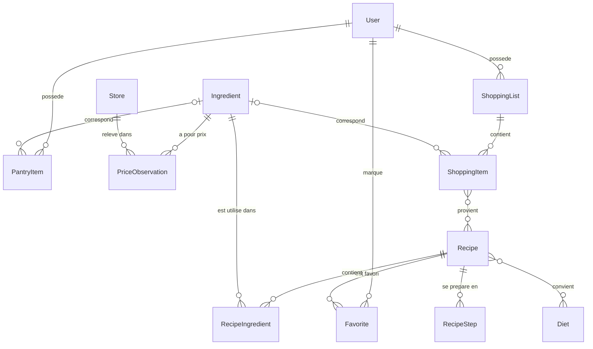

## Recettes (`apps.recipes`)

| Modèle | Rôle | Champs notables |
| --- | --- | --- |
| `Ingredient` | Ingrédient générique, relié aux données ouvertes | `off_category` (taxonomie Open Food Facts), `impactco2_slug` (ADEME), `ciqual_code` et valeurs pour 100 g (`kcal_100g`, `proteins_100g`, `fat_100g`, `carbs_100g`), `price_unit` (kg, l ou unité), `unit_weight_g` (poids d'une pièce), `aisle` (rayon), `is_staple` (produit de base supposé disponible) |
| `Recipe` | Recette | métadonnées (type, difficulté, portions, durées, origine), image et crédits (`image_credit`, `image_license`, `image_license_url`, `image_source`), métriques calculées non éditables (`cost_per_serving`, `price_coverage`, `co2_per_serving`, `kcal`, `proteins_g`, `fat_g`, `carbs_g`, `nutrition_coverage`, `metrics_updated_at`), `search_text` |
| `RecipeIngredient` | Ligne d'ingrédient | `quantity` (facultative), `unit`, `note`, `position` |
| `RecipeStep` | Étape | `position`, `text` |
| `Diet` | Régime (végétarien, sans gluten...) | `name`, `slug` |
| `Favorite` | Recette favorite d'un utilisateur | unique par couple utilisateur et recette |

Les unités de recette (`g`, `kg`, `ml`, `cl`, `l`, `piece`, `tbsp`, `tsp`, `pinch`) et les unités de prix (`kg`, `l`, `unit`) sont définies dans `apps/recipes/units.py`, avec les conversions : densité 1 pour les liquides et les cuillères, poids d'une pièce pour les ingrédients vendus à l'unité.

### Index de recherche

`Recipe.search_text` contient le titre, le résumé, l'origine, le type de plat, les ingrédients et les régimes, en minuscules et sans accents (`apps.core.text.normalize`). Il est mis à jour :

- à chaque `Recipe.save()` ;
- par les signaux de `apps/recipes/signals.py` quand un `RecipeIngredient` est créé, modifié ou supprimé, ou quand les régimes changent.

La recherche découpe la requête en mots et exige que chacun figure dans `search_text`. Elle fonctionne donc à l'identique sur SQLite et PostgreSQL.

## Prix (`apps.pricing`)

| Modèle | Rôle | Champs notables |
| --- | --- | --- |
| `Store` | Magasin OpenStreetMap | `osm_type` et `osm_id` (uniques ensemble), `brand` normalisée, coordonnées, `logo_url` |
| `PriceObservation` | Relevé Open Prices | `source_id` (identifiant Open Prices, unique), `price`, `unit_price` et `base_unit` (prix ramené au kilo, au litre ou à l'unité), `product_code` (vide pour un prix en vrac), `is_discounted`, `observed_on` |

## Garde-manger (`apps.pantry`)

`PantryItem` appartient à un utilisateur et peut être relié à un `Ingredient`. Il porte les informations Open Food Facts (code-barres, marque, image, Nutri-Score, Green-Score), une date de péremption, une valeur estimée et un statut : `in_stock`, `consumed` ou `wasted` (avec `closed_on`). L'urgence (`expired`, `soon` sous 3 jours, `ok`, `none`) est calculée à partir de `expires_on`.

## Courses (`apps.shopping`)

`ShoppingList` appartient à un utilisateur et peut être archivée. `ShoppingItem` est soit relié à un ingrédient (quantités fusionnées par ingrédient et unité), soit un article libre ; il garde la trace des recettes d'origine et son état coché.

## Utilisateurs (`apps.accounts`)

`User` remplace le modèle Django par défaut : pas de nom d'utilisateur, connexion par email (`USERNAME_FIELD = "email"`). Il porte la taille du foyer, la localisation (code postal, ville, latitude, longitude, rayon de recherche) et la préférence de rappels par email. Supprimer un compte supprime en cascade son garde-manger, ses listes et ses favoris.

## Modèle abstrait

`apps.core.models.TimeStampedModel` ajoute `created_at` et `updated_at` à `Recipe`, `PantryItem` et `ShoppingList`.
