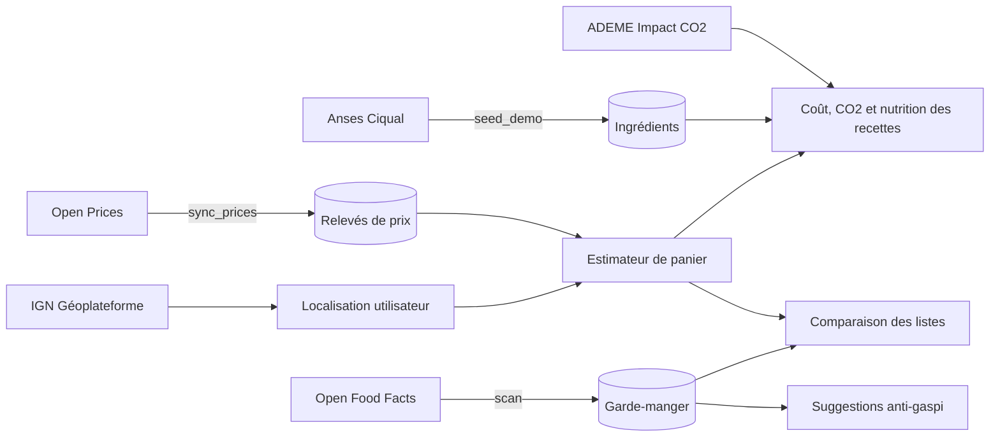
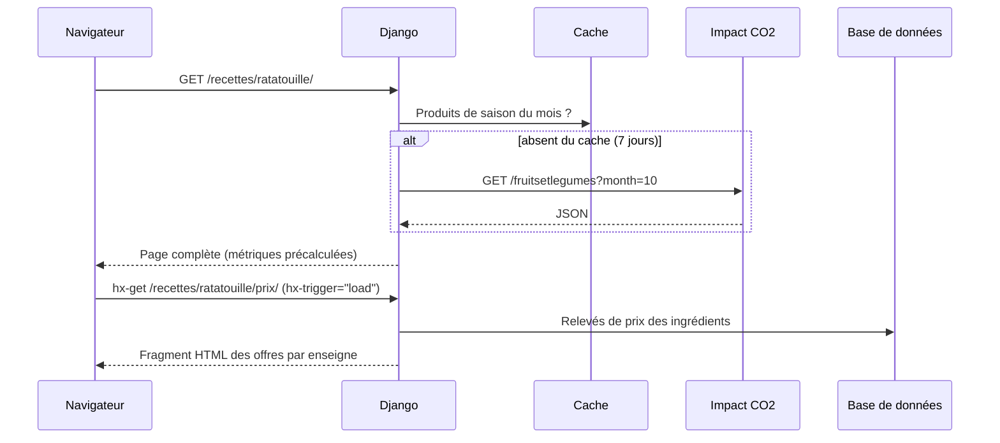

Comégusto est un monolithe Django 5.2 rendu côté serveur. Les interactions (filtres, portions, favoris, cases à cocher) passent par HTMX, qui remplace des fragments de page renvoyés par les mêmes vues. Une API REST expose les mêmes données aux clients externes.

## Principes

- **Une seule source de vérité métier** : les calculs (prix, CO2, nutrition, garde-manger, courses) vivent dans des modules Python appelés par les vues, l'API et les commandes.
- **Les données ouvertes ne bloquent jamais une page** : chaque appel externe a un délai maximal, est mis en cache, et une panne est mémorisée pour ne pas être retentée à chaque requête. Voir [Intégrations](/reaco_updated/architecture/integrations/).
- **Métriques précalculées** : coût, CO2 et valeurs nutritionnelles des recettes sont stockés sur le modèle `Recipe` et recalculés après chaque synchronisation des prix ou modification dans l'administration.
- **Configuration par l'environnement** : aucun secret ni réglage de production dans le code.
- **Sécurité par défaut** : CSP stricte, HTTPS, cookies sécurisés et isolation des données par utilisateur. Voir [Sécurité](/reaco_updated/architecture/securite/).

## Applications

| Application | Responsabilité | Modules clés |
| --- | --- | --- |
| `core` | Accueil, tableau de bord, saison, contact, santé, balises de templates | `middleware.py`, `ratelimit.py`, `text.py`, `templatetags/comegusto.py` |
| `accounts` | Modèle `User` (connexion par email), profil, géocodage, suppression du compte | `models.py`, `forms.py` |
| `recipes` | Ingrédients, recettes, unités, recherche, métriques | `units.py`, `metrics.py`, `forms.py`, `signals.py` |
| `integrations` | Clients des services ouverts | `http.py`, `openprices.py`, `openfoodfacts.py`, `impactco2.py`, `geocoding.py` |
| `pricing` | Magasins, relevés de prix, synchronisation, estimateur | `sync.py`, `estimator.py` |
| `pantry` | Garde-manger, scan, statistiques, suggestions, rappels | `services.py` |
| `shopping` | Listes de courses, fusion, déduction du stock, comparaison | `services.py` |
| `api` | API REST et schéma OpenAPI | `views.py`, `serializers.py` |
| `guide` | Guide utilisateur intégré (`/guide/`) et captures annotées | `content.py`, `management/commands/capture_guide.py` |

Les modèles de `recipes` (ingrédients, unités) sont la base commune : `pricing`, `pantry` et `shopping` s'appuient dessus. `recipes.metrics` utilise en retour l'estimateur de `pricing` pour chiffrer les recettes.

## Flux de données

## Cycle d'une requête

Exemple de la fiche recette :

Les prix affichés viennent des relevés déjà importés par `sync_prices` : aucune page n'interroge Open Prices en direct, sauf le scan d'un code-barres dans le garde-manger.

Les vues détectent HTMX grâce à `django-htmx` (`request.htmx`) et renvoient alors un fragment (`templates/*/_*.html`) au lieu de la page entière.

## Tâches de fond

Il n'y a pas de file de tâches : les traitements périodiques sont des commandes de gestion lancées une fois par jour par le service `scheduler`, une tâche cron ou GitHub Actions. Voir [Tâches planifiées](/reaco_updated/deploiement/taches-planifiees/).
